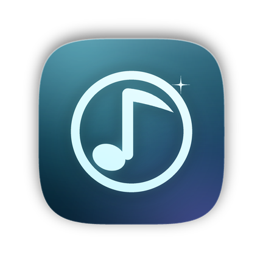

<div align="center">



# OxygenForge Music

### A liquid-glass music player for Android

[](LICENSE)

</div>

OxygenForge Music is an Android music player built on [BitChord](https://github.com/kushagrasinghx/BitChord).
It keeps BitChord's playback engine and feature set, and adds its own identity: a new application id
(`com.oxygenforge.music`), an original OxygenForge launcher mark, a selectable icon set, and a liquid glass
interface that is on by default and can be switched off in Settings.

> [!IMPORTANT]
> OxygenForge Music is not affiliated with, endorsed by, or connected to YouTube, Google, or the BitChord
> author. It is an independent GPL-3.0 derivative. Use it at your own discretion.

## Features

- Streaming playback and search, plus a local-files library with folder browsing.
- Downloads and an offline cache, with per-connection quality ceilings.
- Synced and translatable lyrics, equalizer, AutoMix transitions, sleep timer.
- Liquid Glass surfaces (Android 12+) with a plain, GPU-free fallback on older devices.
- Home-screen icon picker: default mark, or glass variants in light, dark and clear finishes.
- Companion apps in the repository for Wear OS and Android TV.

## Install

Grab the signed APK from the [Releases](https://github.com/OxygenForge-code/oxygenforge-music/releases)
page, or build it yourself (below). Sideloading needs "Install unknown apps" allowed for whichever app
opens the file.

F-Droid builds this source itself and signs the result with F-Droid's key; the APKs published here are
signed with the maintainer's own key and are not byte-identical to an F-Droid build.

## Build

Requirements: JDK 17 or newer, Android SDK with platform 37 and build-tools, CMake and an NDK for the
native decoder.

```bash
# Point the build at your SDK (created locally, never committed):
echo "sdk.dir=/path/to/Android/sdk" > local.properties

./gradlew :app:assembleProdDebug      # debug APK, debug-signed
./gradlew :app:assembleProdRelease    # release APK; signs only if keystore.properties exists
```

Signing is configured through `keystore.properties` (`keystore.properties.example` shows the keys). That
file, the keystore itself, `local.properties` and all build outputs are git-ignored; no key material is in
this repository. See [docs/RELEASING.md](docs/RELEASING.md) for the full release, Play and F-Droid notes.

## Licence and attribution

OxygenForge Music is distributed under the **GNU General Public License v3.0** — see [LICENSE](LICENSE).
It is derived from BitChord by Kushagra Singh and contributors; upstream copyright notices, third-party
licence texts and the vendored LGPL-2.1 decoder notice are preserved unchanged. What changed in this
derivative, and which licences the tree carries, is recorded in [NOTICE.md](NOTICE.md).

Because this is GPL-3.0 software, anyone distributing a binary must also make the corresponding source
available under the same licence. The source for every released OxygenForge Music build is this
repository, tagged per release.

## Contributing

Bug reports and pull requests are welcome — read [CONTRIBUTING.md](CONTRIBUTING.md) first. Contributions
are accepted under GPL-3.0.
